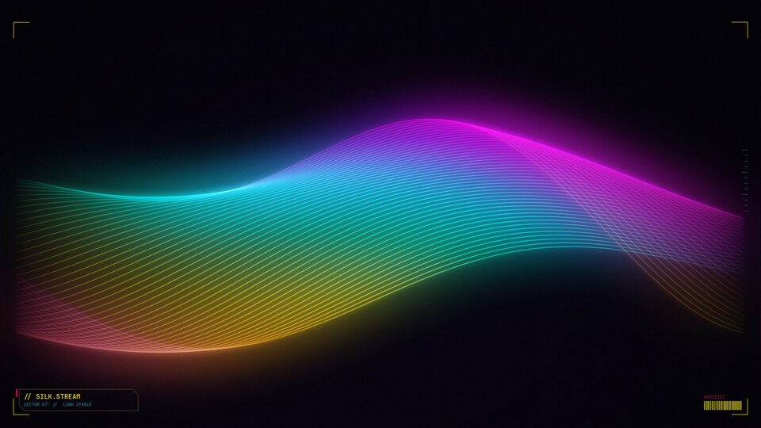

# Spectral

The full neon spectrum on a near-black base, with an acid-yellow accent and a six-colour gradient on every window border.

A dark theme for Aequalyn by qempexe, with six 4K wallpapers and two live loops.



## Palette

| Key | Value |
| --- | --- |
| bgBase | `#0a0612` |
| bgSurface | `#150b24` |
| bgHover | `#1f1133` |
| bgSelected | `#3d0a6b` |
| bgBorder | `#2c1a48` |
| textPrimary | `#e0f7ff` |
| textSecondary | `#b3c4dc` |
| textMuted | `#7a6a9a` |
| accentPrimary | `#fcee0a` |
| accentCyan | `#00f0ff` |
| accentGreen | `#00ff9f` |
| accentOrange | `#ff7b00` |
| accentRed | `#ff2a6d` |
| borderColors | `#ff00c8`, `#ff2a6d`, `#fcee0a`, `#00ff9f`, `#00f0ff`, `#8a00ff` |

## Backgrounds

- `1-contours.jpg`
- `2-crystal.jpg`
- `3-silk.jpg`
- `4-rosette.jpg`
- `5-tunnel.jpg`
- `6-nebula.jpg`
- `7-live-warp.mp4`
- `8-live-silk.mp4`

## Install

In the Store, under Get → Themes, or:

```sh
aequalyn-store install theme https://github.com/qempexe/aequalyn-theme-spectral
```

## License

MIT (the palette), CC-BY-4.0 (the backgrounds).
